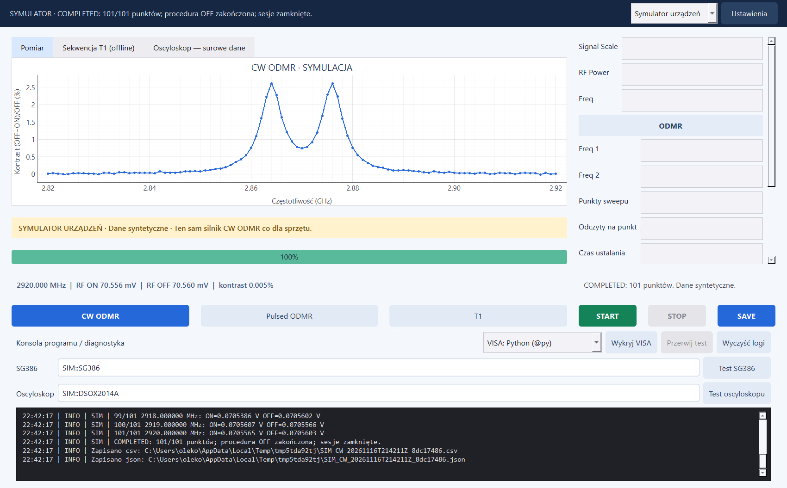

# NV Lab Automation — pakiet roboczy inżynierki

**Status 2026-11-16: prototyp CW ODMR, Pulsed ODMR, T1 i T2 echo z GUI i symulatorami, przygotowany przy wsparciu AI.**
Przetestowano symulatory, sterowniki przez lokalne serwery SCPI i przepływ GUI.
Fizyczna walidacja na stanowisku pozostaje do wykonania.

## Uruchomienie na jutro

Wersja Windows bez instalacji Pythona: **`dist/NVLab.exe`** po zbudowaniu
przez `scripts/Build-EXE.ps1 -Install`. Uruchom EXE dwuklikiem; domyślnie
wybrany jest symulator. Dane i ustawienia zapisywane są obok EXE.
Do USB nadal potrzebna jest zainstalowana biblioteka NI/Keysight VISA.

```powershell
py -3.12 -m venv .venv312
.\.venv312\Scripts\python.exe -m pip install --upgrade pip
.\.venv312\Scripts\python.exe -m pip install --only-binary=h5py -e ".[gui,hardware]"
.\.venv312\Scripts\python.exe -m nv_lab.ui
```

Domyślnie wybierany jest **Symulator urządzeń / CW ODMR**. Kliknij START.
Ustawienia sprzętu, kanałów, I/Q, symulowanych awarii i zapisu są pod przyciskiem
**Ustawienia**. Zmiana na **Stanowisko — sprzęt** jest jawna i nie otwiera sama połączeń.

Dostępne są również **Pulsed ODMR**, **T1** oraz **T2 echo**: wybierz tryb i START
w symulatorze. **Podgląd sekwencji** pokazuje harmonogram, a **Czasy / okna / kalibracja π**
pozwala ustawić jawne okna odczytu. W sprzęcie wymagane są sprawdzone czasy i okablowanie.
Pochodzenie czasów i test oscyloskopu: [CZASY_I_WALIDACJA.md](docs/CZASY_I_WALIDACJA.md).

Pełna procedura: [URUCHOMIENIE_ODMR.md](docs/URUCHOMIENIE_ODMR.md).
Źródła i założenia: [SPRZET_I_ZRODLA.md](docs/SPRZET_I_ZRODLA.md).



## Cel
Budowa modułowego programu do automatyzacji eksperymentów NV: CW ODMR, pulsed ODMR i T1, z QCoDeS, Pulse Streamer 8/2, SRS SG386, oscyloskopem oraz GUI PySide6.

## Co działa w tym pakiecie
- Bezsprzętowy generator harmonogramu **ideowej** sekwencji T1 i kontrola nieujemnych czasów.
- Eksport sekwencji do reprezentacji wzorców kanałów (bez przesyłania do sprzętu).
- Testy jednostkowe standardowym `unittest`.
- Demo CLI pokazujące czasy impulsów; **brak pomiarów rzeczywistych i brak symulowanych odczytów udających aparaturę**.
- GUI PySide6 z podglądem sekwencji, konsolą i testami komunikacji na żądanie.
- CW ODMR: sweep częstotliwości, odczyty RF OFF/ON, uśrednianie programowe,
  kontrast, surowe przebiegi, STOP, automatyczny zapis JSON/CSV i dziennik częściowy.
- Stanowe symulatory SG386, Pulse Streamera, oscyloskopu, bramki lasera i HMP4040.
- Rzeczywiste adaptery CW: SG386/QCoDeS, Pulse Streamer i DSO-X 2014A/PyVISA.
- Silnik impulsowy: T1 z parą bez π / z π, Pulsed ODMR ze sweepem częstotliwości,
  T2 echo Hahna z końcowym π/2 o fazie 0°/180°, zewnętrzny trigger i uśrednianie
  oscyloskopu. Zapis obu surowych przebiegów, sekwencji i okien integracji.
- Diagnostyka skali oscyloskopu WORD/ASCII na zatrzymanym rekordzie.
- Osobny tryb `python -m nv_lab.ui --demo`: animowane wykresy i logi z jawnie
  oznaczonymi danymi syntetycznymi; bez dostępu do aparatury.

## Co jeszcze nie działa
- Walidacja fizyczna sterowników i synchronizacji impulsowej, automatyczne Rabi,
  dopasowanie T1/T2/rezonansów i przeliczenie na pole magnetyczne. Działający
  symulator nie oznacza walidacji pomiarowej stanowiska.
- Parametry lasera, polaryzacja bramkowania, opóźnienia torów, rzeczywiste okna detekcji i dopasowanie muszą zostać ustalone w laboratorium.

## Pierwsze kroki
```bash
python -m unittest discover -s tests -v
PYTHONPATH=src python -m nv_lab.demo
```
W Windows PowerShell: `$env:PYTHONPATH='src'; python -m nv_lab.demo`.

Demonstracja interfejsu (po przygotowaniu `.venv`):

```powershell
.\.venv\Scripts\python.exe -m pip install -e ".[gui]"
.\.venv\Scripts\python.exe -m nv_lab.ui --demo
```

Wybierz tryb i kliknij START. Instrukcja: [docs/UI_IMPLEMENTACJA.md](docs/UI_IMPLEMENTACJA.md).

## Zasady bezpieczeństwa
Uruchomienie w trybie sprzętowym wymaga zatwierdzonych limitów, weryfikacji okablowania i polaryzacji wejść oraz zgody opiekuna stanowiska. W projekcie **nie ma żadnego automatycznego połączenia z aparaturą**.

## Geneza
Materiały źródłowe: dwa pliki `NV-Mariusz*.py` udostępnione przez użytkownika; przeglądane jako kod referencyjny. Nie są dołączone do paczki z uwagi na potencjalne prawa i poufność; wykorzystanie lub publikację kodu historycznego uzgodnij z promotorem.

Spis plików: `docs/PRACA_INZYNIERSKA.md`, `docs/ARCHITEKTURA.md`, `docs/WYMAGANIA_I_TESTY.md`, `docs/LITERATURA.md`, `docs/ETYKA_AI.md`, `docs/GUI_SPEC.md`, `docs/SPOTKANIE_Z_PROMOTOREM.md`.
